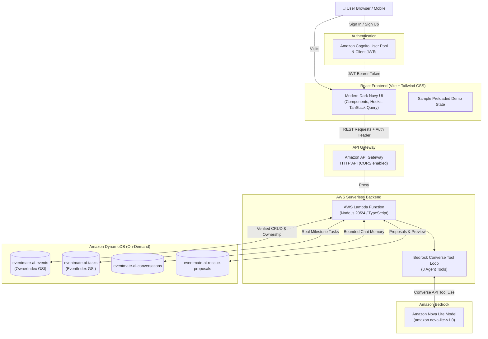

# EventMate AI ⚡
> **"Your AI Co-Organiser, From Idea to Event Day."**

Built for the **AWS Builder Center Weekend Challenge: Build an Agent People Actually Enjoy Using** (`#agents`).

EventMate AI is an intelligent event planning assistant designed specifically for university students, club leaders, volunteer teams, and community organisers. Rather than acting as a generic conversational chatbot, EventMate AI functions as a true co-organiser: converting event ideas into actionable preparation checklists, tracking readiness scores against live database records, and providing a calm, structured **Plan Rescue** workflow when last-minute crises strike.

---

## 🌟 Key Working Features

### 1. Natural Language Event Planning
- Organisers describe their event in natural language (e.g., *"I want to organise an AWS hands-on workshop for 100 students in Colombo on 20 November 2026 with a budget of LKR 25,000"*).
- EventMate gathers essential details without exhausting the user, makes clear assumptions for missing details, and generates a structured plan with tailored milestones.

### 2. Intelligent Task Management & Readiness Scoring
- All preparation tasks are stored in **Amazon DynamoDB** with unique IDs, categories, priorities (`high`, `medium`, `low`), statuses (`not_started`, `in_progress`, `completed`), and deadlines.
- Real-time readiness calculation is derived from actual database records (no fake metrics).
- Inline toggles allow organisers to update task statuses instantly.

### 3. Signature Feature: Plan Rescue 🛟
- **Calm Crisis Resolution:** When unexpected disruptions occur (speaker cancels the night before, venue becomes unavailable, budget gets slashed), organisers click **Plan Rescue**.
- **Reassuring Tone:** Responds calmly (*"No panic. Let's work through this."*) to prevent organizer panic.
- **Dependency Triage:** Pinpoints affected milestones and formulates 2–3 actionable pivot strategies.
- **Interactive Change Preview:** Visually distinguishes:
  - 🟢 **Added Tasks** (new contingency actions)
  - 🟡 **Updated Tasks** (altered deadlines/descriptions)
  - ⚪ **Unchanged Tasks** (confirmed deliverables)
- **Safe Atomic Application:** Proposals require explicit user confirmation before modifying stored database records, with full protection against duplicate execution.

### 4. Amazon Bedrock Converse Multi-Turn Tool Agent
- Powered by **Amazon Bedrock** using the **Amazon Nova Lite** foundation model (`amazon.nova-lite-v1:0`).
- Implements 8 discrete agent tools using the Bedrock Converse API with bounded execution limits and conversation memory persistence.

### 5. Instant Public Demo Mode
- A dedicated **"Explore Demo"** feature on the landing page loads preloaded demonstration data (the AWS Workshop scenario) so evaluators can inspect and test the full application immediately without waiting for Cognito email verification or AWS cloud setup.

---

## 🏗️ Architecture



---

## 🛠️ Technology Stack

| Layer | Technology | Purpose |
|---|---|---|
| **Frontend** | React 18, TypeScript, Vite, Tailwind CSS, Lucide React, React Router | Modern, dark-navy SaaS interface with glassmorphism and mobile responsiveness |
| **Backend** | AWS Lambda, Node.js 24 / TypeScript, Express adapter | Modular REST handlers with Zod validation |
| **AI Foundation** | Amazon Bedrock (`amazon.nova-lite-v1:0`), Bedrock Converse API | Multi-turn reasoning, tool calling, and calm co-organiser responses |
| **Database** | Amazon DynamoDB (Single-key + GSI, On-Demand billing) | Persistent storage for Events, Tasks, Conversations, and Rescue Proposals |
| **Authentication** | Amazon Cognito User Pools | JWT-based user authentication and verified `sub` identity |
| **API Gateway** | Amazon API Gateway HTTP API | Low-latency, cost-effective API routing with CORS |
| **Infrastructure** | AWS CDK (TypeScript) | Declarative Infrastructure as Code (IaC) |
| **Testing** | Vitest, React Testing Library, jsdom | Automated unit and integration testing |

---

## 🚀 Local Development Setup

### Prerequisites
- Node.js v20+ or v24+
- npm v10+
- (Optional for cloud deployment) AWS CLI configured with active credentials

### 1. Clone & Install Dependencies
```bash
git clone https://github.com/PamudaUposath/EventMate-AI.git
cd EventMate-AI
npm install
```

### 2. Configure Environment Variables
Copy the example environment configuration:
```bash
cp .env.example .env
```

Key environment settings:
```env
AWS_REGION=us-east-1
BEDROCK_MODEL_ID=amazon.nova-lite-v1:0
USE_MOCK_DB=true            # Set to false when connecting to live DynamoDB tables
USE_MOCK_BEDROCK=true       # Set to false when calling live Amazon Bedrock Nova Lite
PORT=3001
VITE_API_BASE_URL=http://localhost:3001
```

### 3. Run Backend & Frontend Locally
Run the backend Express development server:
```bash
npm run dev:backend
```
In a separate terminal, run the Vite frontend development server:
```bash
npm run dev:frontend
```

Open your browser to: **`http://localhost:5173`**

---

## 🧪 Automated Testing

EventMate AI comes with a comprehensive automated test suite covering backend ownership checks, task progress mathematics, Plan Rescue previews, Bedrock tool validation, and frontend components:

```bash
# Run all tests across the monorepo
npm test

# Run backend tests only (12 tests)
npm run test:backend

# Run frontend tests only (6 tests)
npm run test:frontend
```

---

## 🔒 Security Measures

1. **Zero Hardcoded Credentials:** No AWS secret access keys exist in source code or git history.
2. **Authoritative Cognito JWT Validation:** The backend derives `ownerId` strictly from verified JWT `sub` claims; client-supplied IDs are never trusted for authorization.
3. **Database-Level Isolation:** All database reads, updates, and deletes enforce strict ownership checks before modifying records.
4. **Graceful Error Sanitization:** Raw AWS exceptions (such as `ThrottlingException` or `AccessDeniedException`) are caught by backend error middleware and translated into helpful, friendly messages rather than leaking internal details to clients.
5. **Cost Protection:** DynamoDB tables use `PAY_PER_REQUEST` on-demand billing, and the Bedrock agent enforces a maximum 5-iteration loop cap to prevent infinite token cycles.

---

## ☁️ AWS CDK Deployment Instructions

### 1. Build Backend & Infrastructure
```bash
npm run build:all
```

### 2. Synthesize & Review CloudFormation Template
```bash
cd infrastructure
npx cdk synth
```

### 3. Deploy to AWS
```bash
npx cdk deploy
```

Upon successful deployment, CDK outputs:
- `ApiEndpoint`: The live API Gateway HTTP API URL
- `UserPoolId`: Cognito User Pool identifier
- `UserPoolClientId`: Cognito Web Client ID

Update your frontend `.env` with these values and deploy the frontend build (`dist/`) to **AWS Amplify Hosting** or an Amazon S3 + CloudFront distribution.

---

## 📸 Demonstration Screenshots

> *Screenshots capture the live EventMate AI interface across desktop and mobile screens.*

| Section | Description | Placeholder / Image |
|---|---|---|
| **Landing Page** | Modern dark-navy hero with tagline and Explore Demo button | `docs/screenshots/01-landing-page.png` |
| **Event Workspace** | Live readiness score, task board, and budget allocations | `docs/screenshots/02-event-workspace.png` |
| **Plan Rescue Modal** | Calm AI problem triage and interactive Change Preview | `docs/screenshots/03-plan-rescue.png` |
| **AI Co-Organiser** | Bedrock Nova Lite converse chat with tool execution tags | `docs/screenshots/04-ai-assistant.png` |

---

## 🔮 Future Improvements

1. **Export to PDF & iCalendar:** One-click download of the event master checklist and sync deadlines to Google/Outlook Calendar.
2. **Multi-Organiser Collaboration:** Role-based permissions for co-leads and volunteers.
3. **Automated WhatsApp/Email Attendee Broadcasts:** Direct integration with Amazon SES for sending participant announcements when plans pivot.
4. **Post-Event Survey Analysis:** AI sentiment analysis on attendee feedback forms to extract recommendations for the next iteration.

---

## 📄 License
MIT License. Created for the AWS Builder Center Weekend Challenge.
